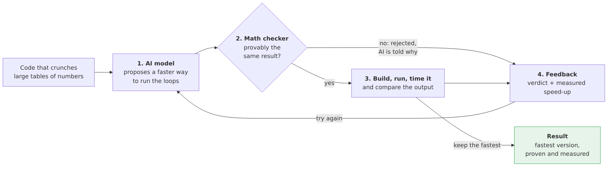
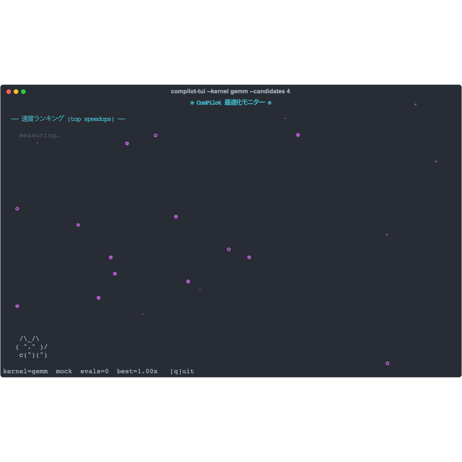

# cluster_compilot

**An AI agent that makes number-crunching code run faster, and a math engine that proves every change is safe before it is used.**



## In plain words

Much of the world's heavy computing, such as training AI models, weather forecasts, physics simulations or financial risk models, spends most of its time repeating a few calculations over huge tables of numbers. How a program walks through those numbers (in which order, in which chunks, and on how many processor cores at once) can make the same calculation **10 to 40 times faster or slower**, with exactly the same result.

Finding the best arrangement is specialist work. This project hands it to an AI model, with a safety net:

1. **The AI proposes** a new arrangement of the calculation.
2. **A mathematical checker proves** that the new arrangement still computes exactly the same result. If it can't prove it, the idea is rejected and the AI is told why. This uses the *polyhedral model*, a branch of compiler mathematics also used inside production compilers such as LLVM's Polly.
3. **The new version is built, run and timed** against the original, and its output is compared with the original's.
4. **The AI gets the verdict and the measured speed-up**, and tries again. The fastest version that was both proven and measured wins.

Think of a creative junior engineer (the AI), a strict reviewer who can prove whether a change is safe (the checker), and a stopwatch. Nothing the AI suggests is used until it has been proven correct and measured.

## Results

| What was measured | Result |
|---|---|
| Matrix multiplication, the core operation of AI models, at the standard benchmark size | **10× faster** |
| Average over 14 standard benchmark programs | **3× faster** |
| Against the simple automatic approach (running the outer loop on all cores) | **1.55× faster** on average, **4.3×** on matrix multiplication |
| Best run with a live AI model (Google Gemini) on matrix multiplication, earlier version, single measurement | **42× faster** |
| Correctness | every accepted change is proven safe, and its output is checked against the original |

The programs come from PolyBench, the standard benchmark suite for this kind of optimization, and were timed on a shared 16-core Linux machine, so read the numbers as indicative. The [engineering section](#for-engineers) has the details and caveats.

## Why it matters

- **Speed is money and energy.** A calculation that runs 10× faster needs a tenth of the computing time: lower cloud bills, less electricity, quicker results.
- **AI that can be trusted with critical work.** AI models make confident mistakes. This project shows one way to use them safely: let the AI be creative, but check every suggestion with mathematics and real measurements before accepting it.

## What's in the project

- **A research paper rebuilt from scratch.** It reimplements *ComPilot* (PACT 2025, [arXiv:2511.00592](https://arxiv.org/abs/2511.00592)) and cross-checks its verdicts against the paper's own research compiler, Tiramisu.
- **The whole standard benchmark.** All 30 PolyBench programs, each in its 5 standard sizes.
- **Several AI models.** Google Gemini, models running on your own machine (Ollama, vLLM and similar), or a team of models whose proposals are all measured and the fastest kept.
- **A tool for AI coding assistants.** Claude Code and OpenAI Codex can call it through the Model Context Protocol (MCP).
- **A live dashboard** in the terminal that shows the search as it happens.
- **Released and tested.** A Docker image for Intel and ARM machines, an npm package, and a Python package (on PyPI from 0.3.1). 19 automated test modules run on every change, on Python 3.14 and 3.15.

## Skills it demonstrates

| Area | In this project |
|---|---|
| AI agents | an LLM in a tool loop with structured feedback, best-of-K search, a mixture of agents, an MCP server |
| Compilers and formal methods | polyhedral dependence analysis, legality proofs and code generation with ISL |
| High-performance computing | C with OpenMP multi-core parallelism, loop tiling and fusion, benchmarking with robust timing statistics |
| Software engineering | Python 3.14/3.15, 19 test modules, continuous integration, code review |
| Release engineering and security | multi-architecture Docker images, npm and PyPI publishing without stored tokens, protection against server-side request forgery, pinned dependencies |

## Words used above

- **Compiler:** the tool that turns code written by people into a program a computer can run.
- **Loop:** a piece of code that repeats a calculation many times. Heavy programs spend most of their time in loops.
- **Speed-up:** how many times faster the new version runs. 10× means it takes a tenth of the time.
- **LLM (AI model):** a large language model such as Gemini or Claude, which can read and write code.
- **Proven safe ("legal"):** the checker has shown mathematically that the new version always produces the same result as the original.

---

## For engineers

A faithful, from-scratch implementation of **ComPilot**: *Agentic Auto-Scheduling: LLM-Guided Loop Optimization* ([arXiv:2511.00592](https://arxiv.org/abs/2511.00592), Merouani, Kara Bernou & Baghdadi, PACT 2025).

An off-the-shelf LLM acts as an agent that proposes loop transformations. A compiler-grade **polyhedral legality engine** proves whether each schedule is legal, and the transformed code is compiled and **executed for real wall-clock speedup**. The LLM iterates on that feedback. No fine-tuning.

> **Status:** runs live. Gemini 2.5-flash + ISL legality + clang execution reached **42× on GEMM** end-to-end (a single noisy run, measured before new bests were re-measured — see [Test results](#test-results)). We also build the **real Tiramisu compiler** and cross-validate our legality against it (**4/4**).

**Live — the agent optimizing GEMM in the TUI monitor** (`compilot-tui`): the speedup leaderboard fills in as schedules are compiled and measured. 🌸




### Documentation

Full docs live in [`docs/`](docs/):

| Doc | What's in it |
|---|---|
| [Architecture](docs/architecture.md) | The four diagrams (rendered + live mermaid): system, dialogue, legality, backends |
| [How it works](docs/how-it-works.md) | Evaluation pipeline (parse → θ′ → ISL legality → measure), feedback categories, the DSL |
| [Building (step by step)](docs/building.md) | Prereqs → deps → key → smoke test → optional Tiramisu build |
| [User guide (step by step)](docs/user-guide.md) | Run the agent, eval, benchmark, tests; write schedules; add a kernel |
| [Parallelism](docs/parallelism.md) | Thread fan-out, the legality and measurement locks, re-measurement, Mixture of Agents |
| [Test results](docs/test-results.md) | Real test + benchmark output, with screenshots |
| [Roadmap](docs/roadmap.md) | What's next, in priority order, with the evidence behind each item |

### Quick start

Requires **Python 3.14+**; CI runs the suite on 3.14 and 3.15 (islpy ships `cp314` and `cp315` wheels; see [Parallelism](#parallelism-python-314) below for why 3.14). To use only the MCP server or the library, `pip install compilot` (on PyPI from 0.3.1) and a clang with OpenMP are enough; the checkout below is for running the tests and benchmarks.

```bash
git clone https://github.com/cluster2600/cluster_compilot.git
cd cluster_compilot
python3.14 -m venv .venv && . .venv/bin/activate
pip install -e .                       # islpy, certifi (from pyproject; requires-python >=3.14)
brew install libomp                    # OpenMP for clang (macOS)

python3 -m tests.test_legality         # prove the legality oracle (10/10)
python3 -m tests.test_parallel_safety  # parallel evaluate() == serial verdicts
python3 run_agent.py --mock            # full agent loop, no API key
python3 run_agent.py --iters 15        # live Gemini (key from env or OpenBao)
python3 run_agent.py --k 5 --candidates 4   # parallel best-of-5, 4 candidate schedules/turn
python3 run_agent.py --backend local --base-url http://localhost:11434/v1 \
        --model qwen2.5-coder:32b           # any OpenAI-compatible server (Ollama/vLLM/NIM/LM Studio)
python3 run_agent.py --moa "gemini:gemini-2.5-flash,local:qwen2.5-coder:32b" \
        --aggregator gemini:gemini-2.5-pro  # Mixture of Agents (pool & measure)
```

#### Parallelism (Python 3.14)

The search fans out across threads: the K dialogues of **best-of-k** run concurrently, and `--candidates N` lets the LLM propose up to N schedules per turn, compiled and measured in parallel. This scales on the standard interpreter because the heavy work (LLM HTTP calls, `clang` compile and run) releases the GIL. Two locks keep it correct: the **legality lock** serializes the (fast) ISL section, because islpy's context isn't thread-safe, and the **measurement lock** lets only one *timed* binary run at a time, so concurrent runs can't bias the speedups being optimized.

A single timed run of a parallel kernel is still noisy (twelve identical GEMM runs on a 16-core box measured 21–67×), so a raw speedup that would set a new best is **re-measured** first (median of fresh runs) and only the confirmed number is kept. `bench.py`/`baselines.py` alternate baseline and candidate runs. Details, timelines and measurements: [docs/parallelism.md](docs/parallelism.md).

#### Mixture of Agents (`--moa`) + local models

Each turn, several **reference** models propose schedules in parallel and an **aggregator** model synthesizes its own, informed by theirs (in the spirit of [Hermes' Mixture of Agents](https://hermes-agent.nousresearch.com/docs/user-guide/features/mixture-of-agents)). Unlike Hermes, whose aggregator picks, ComPilot is **pool & measure**: every proposal is deduped, compiled and **measured**, and the best measured speedup wins.

```bash
python3 run_agent.py --moa "gemini:gemini-2.5-flash,local:qwen2.5-coder:32b" \
        --aggregator gemini:gemini-2.5-pro --candidates 2
```

**Local models** go through one OpenAI-compatible client (`/v1/chat/completions`): Ollama, vLLM, NVIDIA NIM, LM Studio, llama.cpp. Spec format, temperatures and multi-statement behaviour: [docs/parallelism.md](docs/parallelism.md#mixture-of-agents---moa). The [building guide](docs/building.md) and [user guide](docs/user-guide.md) cover the rest (live keys, Tiramisu build, adding kernels).

#### MCP server + TUI monitor

Two extra entry points (installed by `pip install -e .`):

```bash
compilot-tui --kernel gemm --candidates 4    # live curses monitor: speedup leaderboard + falling sakura 🌸
compilot-tui --kernel 2mm --moa mock,mock --aggregator mock   # watch MoA fan-out (multi-statement)
compilot-mcp                                  # MCP stdio server (Claude Code / Codex)
```

The **MCP server** (`compilot/mcp_server.py`, hand-rolled stdio JSON-RPC — no SDK dep) exposes three tools: `list_kernels`, `check_legality(kernel, schedule)` (ISL verdict + one measured speedup, no LLM; the baseline is timed once per kernel+size and reused), and `optimize(kernel, backend=mock, …)` (the full agent loop). Wire it into Claude Code or Codex via the npm launcher — see [`npm/README.md`](npm/README.md):

```bash
claude mcp add compilot -e COMPILOT_PYTHON=$PWD/.venv/bin/python -- npx -y @cluster2600/compilot-mcp
```

The **TUI** (`compilot/tui.py`, stdlib `curses`) watches the parallel search live via a lightweight `on_eval` hook on every runner — single-statement, multi-statement, and MoA fan-out all stream measured candidates into a top-speedups board while a maneki-neko waves on each new record. `--backend mock` runs offline; add `--moa <specs>` to watch the Mixture-of-Agents pool.

### Test results

All suites pass; the benchmark is reproducible (`python3 bench.py`). Full output + screenshots in [docs/test-results.md](docs/test-results.md).


| Suite | Result |
|---|---|
| `test_legality` | **10/10** — accepts interchange/tile/skew; rejects `reverse(k)`; flags `parallel(k)` |
| `test_environment` | GEMM legal schedules run + match the baseline checksum; illegal schedules rejected pre-execution |
| `test_codegen_isl` | **7/7** — typos are `invalid` (no crash); `tile2d`/`tile3d` really tile; skew wavefronts + reversed tiles execute; every kernel's polyhedral domain and written-array accesses match its C |
| `test_confirm` | **4/4** — new bests are re-measured; the agent keeps the confirmed number |
| `test_multistatement` | **3/3** — fused/distributed legal, reordered illegal |
| `test_tiramisu_parity` | **4/4** — our ISL engine agrees with the real Tiramisu compiler |

**Benchmark** (`python3 bench.py`, no LLM): originally reported on Apple Silicon from single timed runs and the old strip-mining `tile2d` — gemm ~26–31× · syrk ~5× · syr2k ~5× · floyd ~1× · **geomean ~5×**; live Gemini **42× GEMM**, ~13× geomean. Each bench speedup is now the median of 5 interleaved baseline/candidate runs; re-measured on a busy 16-core Linux host: gemm 25.8×, **geomean 1.8×** over 15 kernels at the built-in sizes; at PolyBench **LARGE** (the bench default since 0.3.0): gemm 10.4× · 2mm 11.7× · 3mm 7.0× · **geomean 3.0×** over 14 kernels ([details + caveats](docs/test-results.md#polybench-large-030)). Floyd-Warshall stays ~1×: its `i`/`j` loops are parallel in practice (row/column `k` don't change at step `k`), but memory-based dependence analysis can't see that, so they're conservatively rejected.

### Repo layout

| File | Role |
|---|---|
| `compilot/kernels.py` | kernels as schedulable loop nests (exec + poly specs, `REGISTRY`) |
| `compilot/schedule.py` | parse the 9-primitive schedule DSL |
| `compilot/scheduler.py` | transforms → ISL schedule map θ′ |
| `compilot/polyhedral.py` | **ISL legality + parallelism oracle** |
| `compilot/union.py` | several statements as one union (2d+1 schedules): exact legality + ISL codegen for imperfect nests and fusion |
| `compilot/multikernel.py` | multi-statement kernels (sequence of statements, e.g. 2mm): per-statement legality, execution |
| `compilot/codegen.py` · `runner.py` | loops generated by ISL from the proven θ′ + timed C wrapper · compile (`clang -O3 +OpenMP`), run, re-measure |
| `compilot/backend_isl.py` | `Environment`: legality → ISL codegen → measured (and confirmed) speedup |
| `compilot/backends/tiramisu.py` | drive the **real** libtiramisu legality |
| `compilot/prompt.py` · `feedback.py` · `llm.py` · `secrets.py` · `agent.py` | context prompt · 5 feedback categories · Gemini client · OpenBao · dialogue + best-of-K |
| `run_agent.py` · `bench.py` · `baselines.py` · `evaluate.py` | run the agent · benchmark · vs naive auto-parallel · **full metrics (ComPilot@T, CIs, cost)** |
| `tests/` | legality (10/10), codegen ↔ legality agreement, re-measurement, environment, multi-statement (3/3), multi-kernel, stencils, imperfect nests, fusion, MCP, Tiramisu parity (4/4) |
| `third_party/tiramisu/` | exact Tiramisu backend — **built** (`libtiramisu.dylib`); gitignored |

**Kernels — full PolyBench/C 4.2.1 (30/30) + extras:** single — `gemm`, `syrk`, `syr2k`, `syrk_tri`, `syr2k_tri`, `floydwarshall`; multi-statement — `2mm`, `3mm`, `mvt`, `atax`, `bicg`, `gesummv`, `gemver`, `covariance`, `correlation`, `doitgen` (3-D); imperfect-nest solvers/BLAS — `trisolv`, `lu`, `cholesky`, `ludcmp`, `durbin`, `gramschmidt`, `trmm`, `symm`, `nussinov`; stencils — `jacobi1d`, `jacobi2d`, `seidel2d`, `heat3d` (3-D), `fdtd2d`, `adi`, `deriche`. Spanning matmul, matvec, reduction, **triangular**, **fusion**, **in-place**, **datamining**, **3-D**, **time-stepped stencils** (jacobi parallelizes; seidel's in-place 9-point sweep rejects naive parallelism, and the skewed `j+2i` wavefront is proven legal and runs in parallel), and **loop-carried solvers** (sequential carried loops correctly rejected; independent foralls accepted + checksum-verified). Drive any of them: `python3 run_agent.py --kernel <name>`.

### Status & roadmap

**What's next:** [docs/roadmap.md](docs/roadmap.md) — the prioritized plan after 0.3.0 (Python 3.15, PyPI, a Polly baseline, quiet-machine and live-LLM numbers, then parallel reductions and tiling for imperfect nests).

**Working & live:** ISL legality oracle + parallelism check; **every transform executes exactly as proven** — loops are generated by ISL's AST generator from the same θ′ the legality engine checks (incl. `skew` wavefronts and reversed tiles); clang/OpenMP execution; full agent dialogue with Gemini via OpenBao for **both single- and multi-statement** kernels; **30/30 PolyBench kernels** (below); exact Tiramisu backend **built** and driven (ISL↔Tiramisu **4/4**); multi-statement legality (3/3) + execution (2mm live **28.6×**); loop **fusion** (gesummv 1.7×); evaluation harness — **ComPilot@T, ComPilot_K@T, bootstrap 95% CIs, token/cost (RQ1/RQ2/RQ9)**.

**Baseline:** `baselines.py` — **ComPilot vs naive auto-parallelization**: originally geomean **6.17× vs 3.31× → 1.86× faster** (matmul kernels 4.6–6.2× faster; matvec memory-bound, ~1.1–1.35×); re-measured with interleaved medians on the busy Linux host: **2.07× vs 1.62× → 1.27×** at the built-in sizes, and at PolyBench LARGE **4.23× vs 2.72× → 1.55×** (gemm 4.3×, 2mm/3mm ~3× faster; the matvec kernels use identical schedules in both columns, so their ratio is noise). Polyhedral **Pluto** itself does **not build** on this toolchain (Darwin-27/clang-22 rejects its bundled piplib's legacy K&R C — `conflicting types`/`unknown type name`; the LLVM-14 clang++ can't link C++), so naive auto-parallel is the proxy comparison.

**Tiramisu backend — complete:** legality (ISL↔Tiramisu **4/4**) + Halide **codegen** (128 KB object) + **execution** (runs+times its own generated code via a Halide-buffer wrapper: tile2d+parallel → **1.7× measured by Tiramisu**).

**Python 3.15:** supported — islpy 2026.2.2 ships `cp315` wheels, CI runs the whole suite on 3.14 and 3.15, and the suite is **deprecation-clean** on both (passes under `-W error::DeprecationWarning`). Free-threaded `3.15t` still needs a `cp315t` islpy wheel (the same gap as `3.14t`); `python3 check_py315.py` probes PyPI for it.

**full PolyBench/C 4.2.1 — 30/30 kernels × 5 datasets = 150 instances:**
- **30/30 kernels** across every PolyBench category — blas (gemm/gemver/gesummv/symm/syr2k/syrk/trmm), kernels (2mm/3mm/atax/bicg/doitgen/mvt), solvers (cholesky/durbin/gramschmidt/lu/ludcmp/trisolv), datamining (correlation/covariance), medley (deriche/floyd-warshall/nussinov), stencils (adi/fdtd-2d/heat-3d/jacobi-1d/jacobi-2d/seidel-2d) — wired into `optimize`/`check_legality` (and the TUI), each at PolyBench's **5 datasets** (`MINI/SMALL/MEDIUM/LARGE/EXTRALARGE`, pass `size=` / `--size`) — the exact per-kernel sizes from PolyBench 4.2.1's headers (gemm `LARGE` = 1000×1100×1200). `DEFAULT` (the default everywhere) is each kernel's built-in size, small enough for interactive search; 3mm/atax/bicg/fdtd-2d use PolyBench's rectangular shapes. The two non-PolyBench extras (distmatrix, montecarlo) scale their default sizes. **Every computational pattern works**: matmul, matvec, reduction, triangular, multi-statement, fusion, in-place, datamining, time-stepped stencils, 3-D, and the loop-carried solvers.
- **Imperfect nests** (`compilot/imperfect.py`, on `compilot/union.py`) — statements at differing loop depths with sibling inner loops under a loop-carried outer loop (cholesky's per-row j-loop + diagonal k-loop + sqrt; ludcmp's two j-loops + descending back-solve; gramschmidt; durbin; trmm; symm; nussinov). Legality is **exact over all statements**: each statement's domain comes from its loops, its accesses are read from its C body, the loop tree becomes a 2d+1 schedule, setup scalars are 0-d arrays and statement-declared scalars (`double w = …`) are expanded over their loop scope. The scheduled code is generated by ISL (scalars declared in their original scope) and checked against the plain loop-tree baseline. It **rejects** parallelism on every sequential carried loop (cholesky's `i`/`j`/`k`, lu's `k`, trisolv's `i`/`j`, nussinov's `i`/`j`/`k`, durbin/ludcmp) and **accepts + checksum-verifies** the independent ones (lu's `i`/`j`, trmm's `j`, symm's `j`, gramschmidt's `j`/`i2`, durbin's `i2` — the last three missed by the old single-statement model).
- **Fusion** (`fuse(L)` / `shift(L, c)`, multi-statement and stencil kernels): a statement can run inside the previous statement's loops down to `L`; the whole statement sequence becomes one union, every dependence between statements is checked, and ISL generates the fused loops. jacobi's two sweeps can't fuse as-is but can after `shift(i, 1)`; 2mm fuses legally at `i`, not at `j`.
- **Backward sweeps** (adi's Thomas back-substitution, deriche's right-to-left/bottom-up IIR passes, ludcmp's back-solve) run over an ascending index `jj` with `j=N-2-jj`, so the forward-only emitters stay correct while the dependence direction is modeled faithfully.
- *ponytail caveat:* the legality + codegen infrastructure is the deliverable, not solver speedups — the per-step-barrier parallel solvers rarely beat serial `-O3`, and imperfect nests execute `parallel()` only (no tiling/interchange across their statement tree yet).

### Reference

Merouani, Kara Bernou, Baghdadi. *Agentic Auto-Scheduling: An Experimental Study of LLM-Guided Loop Optimization.* PACT 2025. arXiv:2511.00592.
