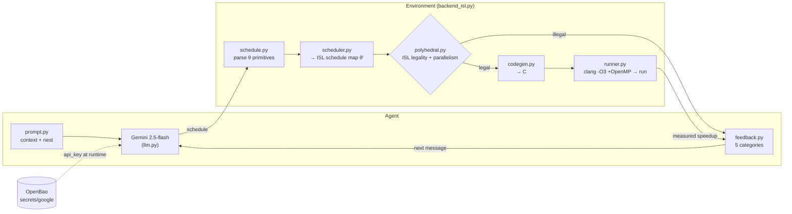
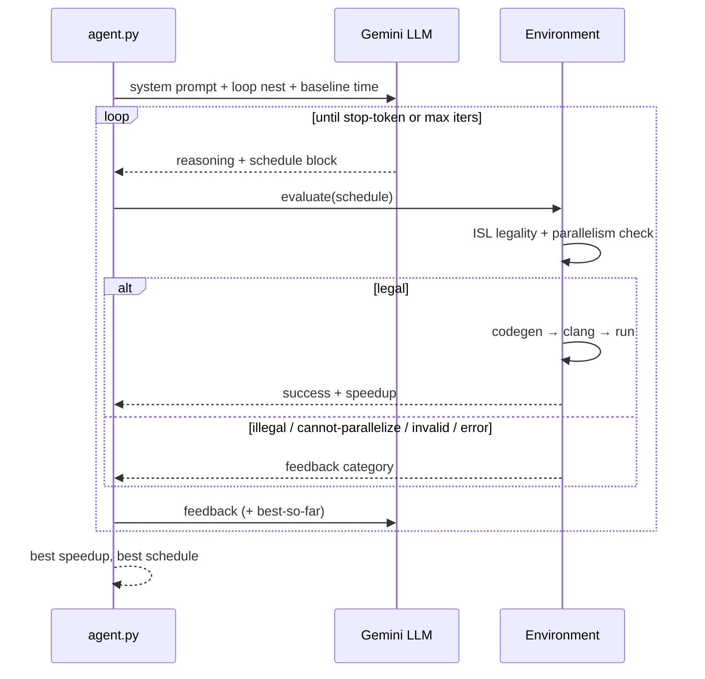
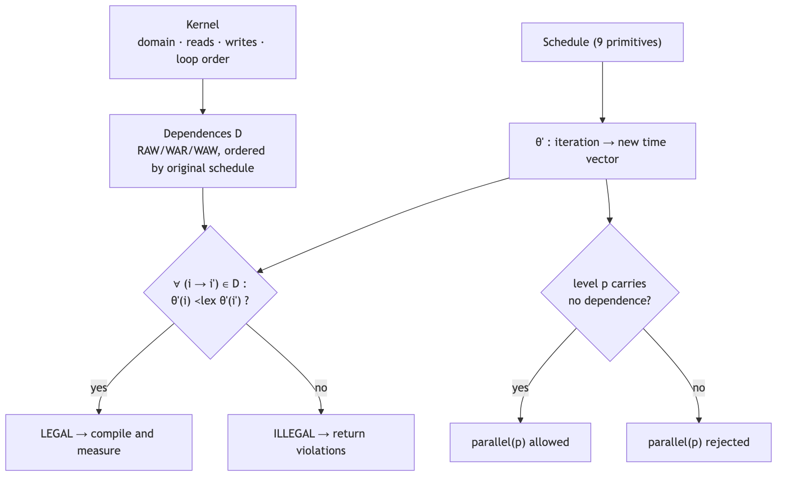
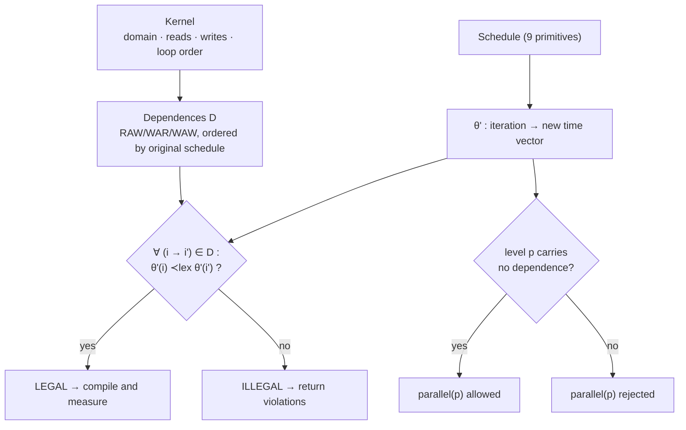
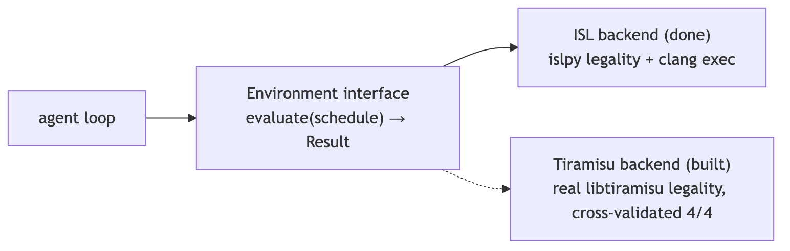
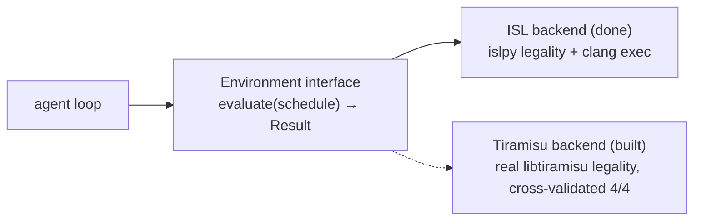
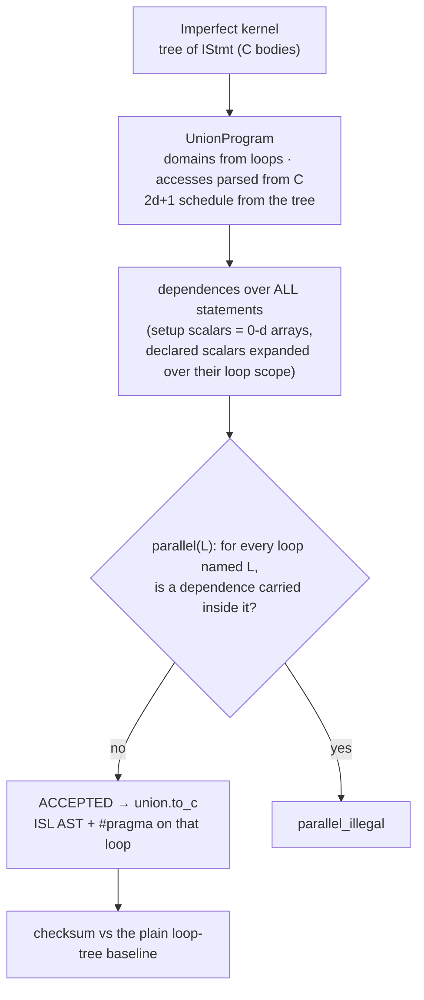

# Architecture

Four views of ComPilot. Each is shown as a rendered image (works everywhere) with its live mermaid source below.

## System architecture

The agent proposes schedules; the environment proves legality (ISL) and measures real speedup (clang). The Gemini key is read from OpenBao at runtime.

mermaid source

## The optimization dialogue

One LLM↔compiler conversation: propose a schedule, evaluate it, feed the outcome back, keep the best legal speedup, stop on the stop-token.

mermaid source

## Polyhedral legality (the faithful core)

A schedule is legal iff every dependence stays lexicographically forward under the new schedule θ′; a loop level is parallel iff it carries no dependence. The LLM can be wrong — this rejects illegal schedules before any code runs.

mermaid source

## Backend abstraction

The same Environment interface is served by the ISL backend (islpy + clang, done) or the real Tiramisu compiler (built, cross-validated 4/4).

mermaid source

## Kernel registries

Four registries in `compilot/kernels.py`, each with its own environment.
Together they cover the full PolyBench/C 4.2.1 set (30/30) at PolyBench's own five
datasets (MINI…EXTRALARGE, from its headers) plus `DEFAULT`, each kernel's built-in
size. In every family scheduled code is generated by ISL from the proven schedule;
baselines are printed from the kernel's C loops, and the checksum comparison between
the two catches any spec/body mismatch.

| Registry | Shape | Codegen | Examples |
|---|---|---|---|
| `REGISTRY` | single statement, perfect nest | `codegen.isl_nest` (ISL AST from θ′) | gemm, syrk, syr2k, floyd-warshall |
| `MULTI_REGISTRY` | a sequence of statements | `multikernel.py` → `isl_nest` per statement | 2mm, 3mm, gemver, covariance, doitgen |
| `STENCIL_REGISTRY` | sequential time loop over spatial sweeps | `stencil.py` → `isl_nest` per statement | jacobi-1d/2d, seidel-2d, heat-3d, fdtd-2d, adi, deriche |
| `IMPERFECT_REGISTRY` | loop-carried solvers / triangular BLAS (tree nest) | `imperfect.py` → `union.to_c` | trisolv, lu, cholesky, ludcmp, durbin, gramschmidt, trmm, symm, nussinov |

## Exact union model (imperfect kernels and fusion)

Imperfect kernels are a *tree* of statements at different depths. `compilot/union.py`
models all of them at once: each statement gets its own iteration domain (from its
loops) and its accesses (read from its C body, sizes substituted), and the loop tree
becomes a 2d+1 schedule — interleaved sibling positions ("betas") and loop
coordinates. Dependences between *any* two statement instances are then checked by
the same `is_legal` / `is_parallel`, and ISL generates the code for the whole union.

This replaced a single-binding-statement model in which legality saw only one
statement per kernel. That model needed hand-added "virtual accumulator" arrays for
reductions off the binding statement's write (issues **#9/#10**: `symm`'s `temp2`,
`gramschmidt`'s `nrm` / `R[k][j]`) and still missed foralls it couldn't see (durbin's
and gramschmidt's `i2` loops are parallel; it rejected them). The union model gets
both right from the C itself.

Two rules keep the parsed model exact:
- an access under a condition (`if`, `?:`) counts unconditionally — that can only
  add dependences, never hide one;
- a scalar declared in a statement (`double w = …`) is private to its innermost loop's
  iterations, so it is modelled as `w[that loop's iterators]` and the generated code
  declares it at the top of that loop's body, exactly its scope in the original C.

The same machinery runs **fusion** (`fuse(L)` / `shift(L, c)`) for multi-statement and
stencil kernels: the statement sequence becomes one union (accesses again read from
the C bodies — across statements, reads of arrays a statement never writes matter),
so a fusion that breaks a producer→consumer dependence is rejected.

The runtime checksum is a backstop, not the proof — a data race can pass a checksum
by luck, so the checksum is also **position-weighted** (`Σ (idx+1)·out[idx]`) to
catch transposed/mirrored writes that an unweighted sum would miss.
