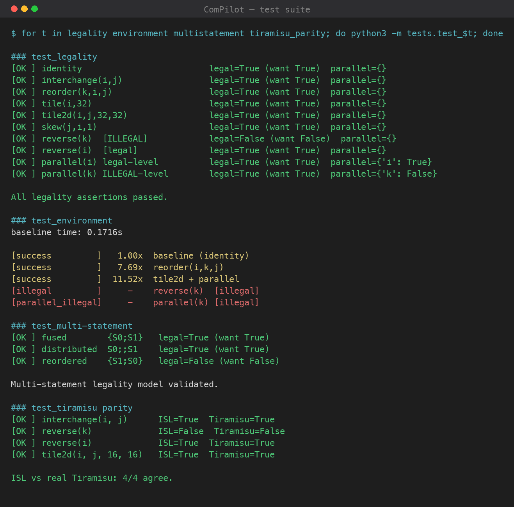
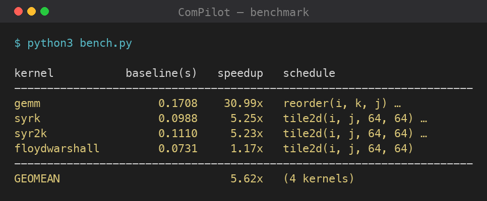
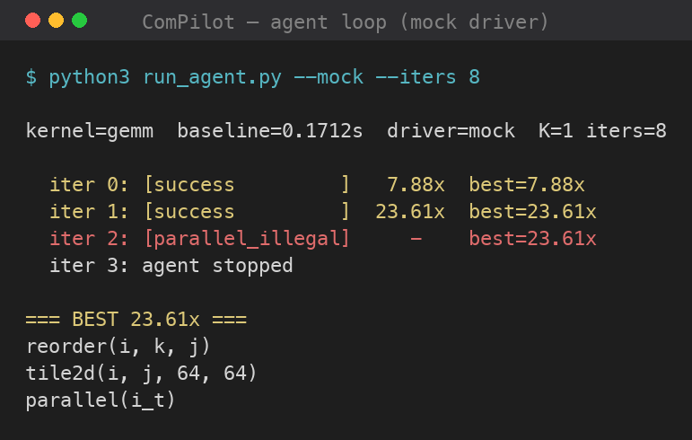

# Test results

All suites pass and the benchmark is reproducible. Captured on a multi-core macOS / Apple-Silicon machine — **speedups are machine-dependent; legality verdicts are not.** Regenerate everything with the commands shown.

> **Measurement note.** The numbers in the tables below were captured before two fixes: `tile2d`/`tile3d` used to strip-mine each loop in place (no real blocking), and every speedup was a single timed run. Bests and benchmark numbers are now re-measured (see [Re-measured on Linux](#re-measured-on-linux)); re-run `python3 bench.py` on your machine for current figures.

## Test suite

```bash
for t in legality environment multistatement tiramisu_parity; do python3 -m tests.test_$t; done
```



| Suite | Result |
|---|---|
| `test_legality` — ISL oracle distinguishes legal vs illegal | **10/10** — accepts interchange/tile/skew; rejects `reverse(k)`; flags `parallel(k)` non-parallelizable |
| `test_environment` — legality + real measured speedup on GEMM | baseline ≈0.17 s; `reorder(i,k,j)` ≈7.7×; `tile2d+parallel` ≈11–14×; `reverse(k)`→illegal; `parallel(k)`→parallel_illegal |
| `test_codegen_isl` — executed code == proven schedule | **7/7** — bad labels are `invalid`; real tiles; skew wavefronts / reversed tiles execute; 60/60 statements' domains + written-array accesses match their C |
| `test_confirm` — re-measured bests | **4/4** — `rerun` / interleaved `ab_speedup`; agent keeps the confirmed number |
| `test_multistatement` — producer→consumer legality | **3/3** — fused legal, distributed legal, reordered (consumer-first) illegal |
| `test_tiramisu_parity` — ISL vs the **real Tiramisu compiler** | **4/4 agree** — interchange, `reverse(k)`=illegal, `reverse(i)`, tile2d |

## Benchmark

One strong, legal schedule per kernel — deterministic, no LLM (`clang -O3 + OpenMP`):

```bash
python3 bench.py
```



| Kernel | Baseline | Speedup | Schedule |
|---|---|---|---|
| gemm | ~0.17 s | **~26–31×** | `reorder(i,k,j)` + `tile2d(64,64)` + `parallel(i_t)` |
| syrk | ~0.10 s | **~5×** | `tile2d(64,64)` + `parallel(i_t)` |
| syr2k | ~0.11 s | **~5×** | `tile2d(64,64)` + `parallel(i_t)` |
| floydwarshall | ~0.07 s | **~1×** | `tile2d(64,64)` — *cannot* parallelize under sound legality |
| **geomean** | | **~5×** | |

Floyd-Warshall at ~1× is the honest, *sound* result: row/column `k` is written and read across iterations, so sound polyhedral analysis forbids parallelizing `i`/`j` (only the non-negative-diagonal *semantics* would allow it, which a syntactic checker cannot assume — Pluto is conservative here too).

## Re-measured on Linux

`bench.py` and `baselines.py` now report `env.confirm(..., interleaved=True)`: the median ratio of 5 alternating baseline/candidate runs. Captured on a 16-core x86-64 Linux (WSL2) host that was **busy** (load average ≈16 from other work), so parallel speedups are depressed — treat these as indicative:

```
kernel           baseline(s)   speedup   type
gemm                  1.8704    25.80x   single     reorder(i,k,j) + parallel(i)
syrk                  0.2632     2.34x   single
syr2k                 0.4471     2.87x   single
syrk_tri              0.1840     2.27x   single
syr2k_tri             0.1383     2.56x   single
floydwarshall         0.3476     0.81x   single
2mm                   0.0886     3.74x   multi
3mm                   0.1100     1.01x   multi
mvt                   0.0847     1.87x   multi
atax                  0.0115     0.73x   multi
bicg                  0.0107     1.14x   multi
gesummv               0.0133     1.06x   multi
gemver                0.0256     0.51x   multi
covariance            0.3956     2.26x   multi
doitgen               0.0142     1.03x   multi
GEOMEAN                          1.79x   (15 kernels)

baselines.py:        naive   ComPilot    ratio
GEOMEAN              1.62x      2.07x    1.27x   (gemm 7.49x, 2mm 4.03x)
```

`atax`, `bicg` and `gesummv` run the *identical* schedule in both `baselines.py` columns, so their ratios (0.68–0.87×) are the residual noise floor on that host. With real tiling, GEMM at N=512 (cache-resident) is fastest with plain `reorder(i, k, j)` + `parallel(i)`: interleaved medians of 34× vs 17–24× for the 64-wide tiled variants, whose 8–16 tile rows leave cores idle.

## Agent loop (live behaviour, mock driver shown)

```bash
python3 run_agent.py --mock --iters 8     # deterministic, no API key
```



With **live Gemini** the agent tailors schedules per kernel and reaches **42× on GEMM** and a **~13× geomean** (`python3 run_agent.py --iters 15`, key from env or OpenBao).

## Evaluation metrics (RQ1 / RQ2 / RQ9)

`evaluate.py` runs a pool of independent dialogues per kernel and reports the paper's metrics: **ComPilot@T** (median single-run speedup), **ComPilot_K@T** (typical best-of-K), bootstrap **95% CIs**, geometric mean, and **token/cost** (RQ2).

```bash
python3 evaluate.py --mock --pool 6 --k 5 --iters 8        # deterministic
python3 evaluate.py --kernels gemm --pool 2 --k 2 --iters 6  # live (real tokens)
```

Mock pool (variance from measurement timing):

```
gemm    ComPilot@8=28.9x  ComPilot_5@8=37.8x  95%CI=[27.5, 35.7]
syrk    ComPilot@8= 3.2x  ComPilot_5@8= 3.5x  95%CI=[ 3.1,  3.4]
syr2k   ComPilot@8= 1.8x  ComPilot_5@8= 2.1x  95%CI=[ 1.7,  2.0]
floyd   ComPilot@8= 1.0x  ComPilot_5@8= 1.0x  95%CI=[ 1.0,  1.0]
GEOMEAN ComPilot@8= 3.6x  ComPilot_5@8= 4.1x  95%CI=[1.33, 14.40]
```

Live (RQ2 cost) — a full GEMM dialogue is **~$0.005** on `gemini-2.5-flash`:

```
gemm  ComPilot@6=34.1x  ComPilot_2@6=39.6x  95%CI=[28.7, 39.6]
RQ2 tokens: in=15,119 out=2,087  est. cost $0.0098 (2 runs)
```

> Bootstrap CIs are reproducible (fixed-seed RNG). The wide geomean CI honestly reflects bootstrapping over only 4 kernels with one large outlier (GEMM).
